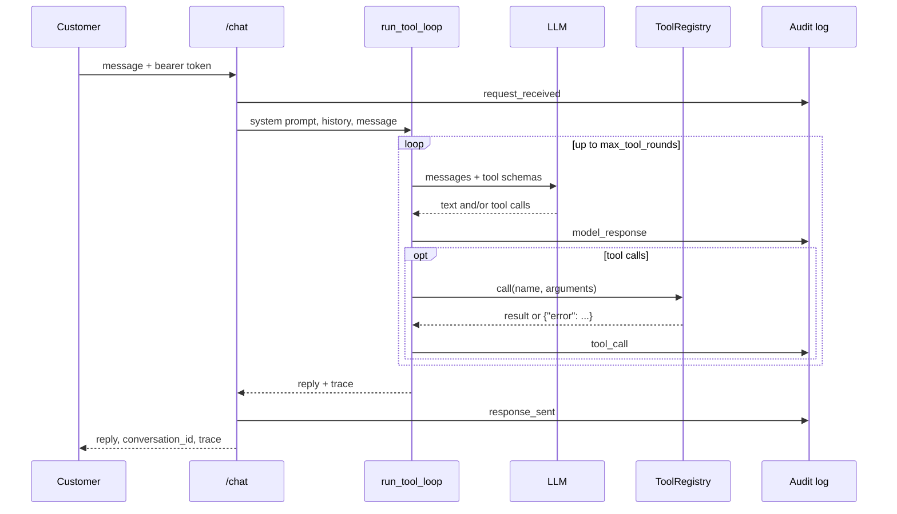

# Architecture notes

These describe the code as of week 3.

## What each module does

| Module | Job |
|---|---|
| `app/main.py` | Builds the FastAPI app: logins, `/chat`, the `/triage/emails` endpoints, and an audit scope per request |
| `app/auth.py` | Fake bearer-token sessions for customers and staff. No passwords, because this is a lab |
| `app/agent.py` | The loop that passes tool calls between the model and the tools. Both assistants use it |
| `app/copilot.py` | The customer assistant's system prompt |
| `app/triage.py` | The triage assistant: its prompt, how an email is put in front of the model, and parsing the model's JSON answer |
| `app/llm.py` | `OllamaClient` talks to a local model; `ScriptedLLM` replays canned replies for tests |
| `app/rag/` | Splits the policy docs into sections, embeds them, and searches them |
| `app/audit.py` | The hash-chained audit log and its `verify` command |
| `app/tools/registry.py` | Describes the tools to the model, checks the arguments it sends, and runs the calls |
| `app/tools/banking.py` | Customer tools, with the baseline holes marked T3 to T8 |
| `app/tools/staff.py` | Triage tools (T13 lives here) |
| `app/db.py` | SQLAlchemy models and engine setup for SQLite or PostgreSQL. Money is stored as whole cents in `BIGINT` columns |
| `app/seed.py` | Generates the same fake customers, staff, transactions and emails every time |
| `app/cli_chat.py` | A terminal chat that prints each tool call, which I use for poking at it by hand |

## What happens on one chat message

Triage works the same way. The "message" is the email, formatted by `format_email`. When the loop
ends, `parse_decision` pulls a JSON object out of the model's last reply. If that fails, the
email is marked `needs_review` instead of `triaged`, so a bad answer is never silently filed.

## Policy retrieval

- Each `## ` section of a policy doc becomes one chunk, with an id like `fees#transfer-fees`.
  The tool returns those ids and the prompts ask the model to cite them, so every policy claim
  can be traced to a section.
- Embeddings come from Ollama (`nomic-embed-text` by default). With only about two dozen chunks,
  a plain list of vectors and a cosine score is all the "vector database" this needs.
- The index is built on the first search, so a missing embedding model only breaks policy
  lookups (the tool returns an error the model can read), not the whole app.
- `HashingEmbedder` is a word-overlap fallback for tests and CI. It's knowingly weak: for
  "international wire fee" it ranks *Processing times* above *Transfer fees*, because both
  mention international wires. There's a test that pins that down.

## The audit log

One JSON record per line. Each record holds `seq`, `ts`, `request_id`, `channel` (`chat`,
`triage`, `auth`, `cli`), `actor` (like `staff:S100`), `event`, the event's own fields,
`prev_hash`, and `hash`, which is SHA-256 over the canonical JSON of everything else. A new
process picks up the chain from the last line in the file. Long strings are clipped at 4,000
characters.

`python -m app.audit verify` walks the file and reports the first line where the sequence, the
`prev_hash` link or the hash itself doesn't check out.

## Where the defenses will go

- **Week 5:** ownership checks, the policy engine, a confirmation step the model can't trigger,
  limits on triage lookups and `send_email`, budgets, and a canary token. These go in the tool
  layer and a new `defenses/` package, called from `ToolRegistry.call` and `run_tool_loop`.
- **Week 6:** marking outside content as untrusted, the input classifier, PII redaction (in
  replies and in the audit log), and output checks. These wrap around `run_tool_loop`.

Every defense will have its own on/off switch in the settings, so I can measure them one at a
time and then all together.

## Choices I made, and why

- **Who's acting always comes from the login session, never from the model.** `ToolContext`
  carries `customer_id` and `actor`, so the week 5 checks can be added without touching tool
  signatures.
- **Customer and staff tokens can't be swapped.** A customer token on a staff endpoint (or the
  other way round) gets a 403 and an `auth_failed` audit record.
- **Bad tool calls never crash a request.** An unknown tool, a missing or extra argument, or
  broken JSON all come back to the model as `{"error": ...}`.
- **Ground truth stays out of the model's view.** Seeded emails carry a `label` and
  `expected_category` for scoring, but the API and the prompt never expose them.
- **Money is stored as whole cents**, and amounts from the model are parsed with `Decimal`.
- **SQLite and PostgreSQL run the same code.** SQLite keeps the tests fast and the setup to zero;
  PostgreSQL is what you'd actually deploy. CI runs the full suite on both, which is how I caught
  the two places SQLite had been forgiving: money columns needed `BIGINT` (a Postgres `INTEGER`
  stops at about $21M in cents), and a too-long account number from the model now gets a clean
  tool error instead of a failed insert. Tables come from `create_all`. A real deployment would
  want migrations (Alembic), which I've left for later.
- **The data is the same on every run.** A fixed seed and a fixed "today" mean an attack I run
  next month hits exactly the same database as one I run today.
