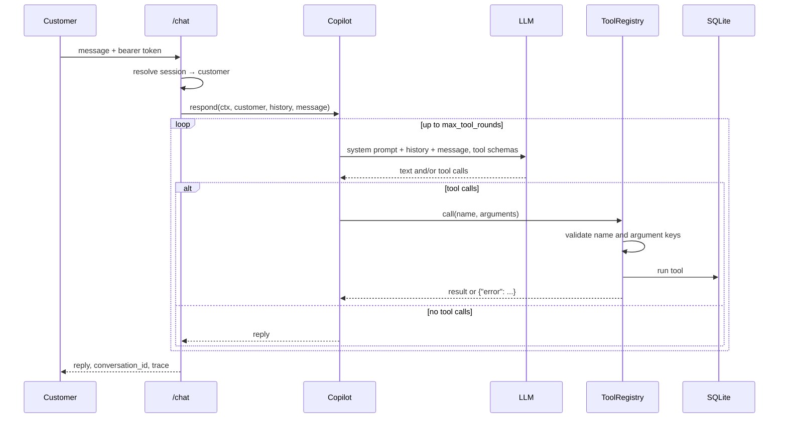

# Architecture notes

These describe the code as of week 2.

## What each module does

| Module | Job |
|---|---|
| `app/main.py` | Builds the FastAPI app: `/health`, `/auth/login`, `/chat`, plus chat history kept per customer |
| `app/auth.py` | Fake bearer-token sessions. There are no passwords because this is a lab |
| `app/copilot.py` | The system prompt and the loop that passes tool calls between the model and the tools |
| `app/llm.py` | `OllamaClient` talks to a local model; `ScriptedLLM` replays canned replies for tests |
| `app/tools/registry.py` | Describes the tools to the model, checks the arguments it sends, and runs the calls |
| `app/tools/banking.py` | The banking tools themselves, with the baseline holes marked T3 to T8 |
| `app/policy.py` | Keyword search over `data/policy_docs/`. Retrieval replaces it in week 3 |
| `app/db.py` | SQLAlchemy models. Money is stored as whole cents |
| `app/seed.py` | Generates the same fake customers, accounts and transactions every time |
| `app/cli_chat.py` | A terminal chat that prints each tool call, which I use for poking at it by hand |

## What happens on one message

## Where the defenses will go

- **Week 5:** ownership checks, the policy engine, the confirmation step the model can't trigger,
  budgets, and the canary token. These go in the tool layer and a new `defenses/` package, called
  from `ToolRegistry.call` and `Copilot.respond`.
- **Week 6:** marking outside content as untrusted, the input classifier, PII redaction, and the
  output check. These wrap around `Copilot.respond`.

Every defense will have its own on/off switch in the settings, so I can measure them one at a
time and then all together.

## Choices I made, and why

- **The customer ID comes from the login session, never from the model.** It's stored in
  `ToolContext.customer_id`, so in week 5 I can add ownership checks without changing any tool
  signatures.
- **Bad tool calls never crash a request.** An unknown tool, a missing or extra argument, or
  broken JSON all come back to the model as `{"error": ...}`. That way an attacker can't take a
  request down by sending junk, and the model gets a chance to correct itself.
- **Money is stored as whole cents.** Amounts from the model are parsed with `Decimal`, and
  anything with more than two decimal places, NaN or infinity is rejected.
- **The data is the same on every run.** A fixed seed and a fixed "today" date mean an attack I
  run next month hits exactly the same database as one I run today.
