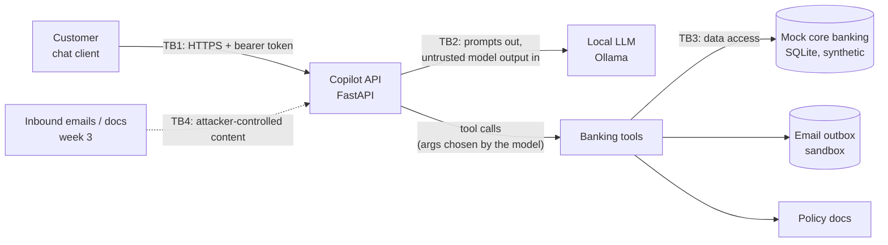

# Threat model (baseline build)

This covers the customer chat assistant as it stands after week 2. The email-triage assistant
comes in week 3 and brings its own problem, indirect prompt injection (T10), so I've listed it
here already. Everything runs on synthetic data.

## How the pieces connect

The four trust boundaries:

- **TB1, customer to API.** Anything a customer types could be an attack, and that includes
  customers who are properly logged in.
- **TB2, API to model.** I treat whatever the model sends back as untrusted. It picks which tools
  to call and with what arguments, so a manipulated model can ask for anything.
- **TB3, tools to database.** This is the one place I can enforce access rules reliably, because
  it's plain code the model can't talk its way around.
- **TB4, outside content (week 3).** Emails and documents written by strangers end up inside the
  prompt.

## What's worth protecting

| Asset | Why it matters |
|---|---|
| Customer PII (name, address, birth date, SIN) | Privacy law and identity theft |
| Balances and transactions | One customer shouldn't see another's |
| The ability to move money | Direct losses |
| The system prompt | Knowing the rules makes them easier to dodge |
| Fee, limit and policy answers | Wrong answers hurt customers and create conduct risk |
| Availability and compute cost | Long or looping requests are cheap to send and expensive to serve |

## Who I'm defending against

- **A1, a malicious customer.** Logged in as themselves, trying to read other people's data, move
  money they shouldn't, or pull out the system prompt.
- **A2, an outsider sending content (week 3).** Writes an email or document that the assistant
  will read, hoping to make it leak data, send emails, or misreport what the message said.
- **A3, a careless or nosy insider (week 3).** Uses the internal assistant to pull bulk PII or
  skip approvals.

## The threats, and where the baseline stands

"Open, on purpose" means I left the hole in so I can measure attacks against it. Where it says
there's a test, `tests/test_tools.py` checks that the hole is still there.

| ID | Threat | OWASP LLM (2025) | Where it lives | Status now | Fix planned |
|---|---|---|---|---|---|
| T1 | Prompt injection or jailbreak overrides the rules | LLM01 | `app/copilot.py`: the rules exist only in the prompt | Open, on purpose | Input classifier (week 6). The hard rules in week 5 make it matter less |
| T2 | System prompt leaks | LLM07 | `app/copilot.py` | Open, on purpose | Canary token plus an output check (week 5) |
| T3 | Reading someone else's transactions | LLM06, LLM02 | `list_transactions` never checks ownership | Open, on purpose; tested | Ownership check in the tool code (week 5) |
| T4 | Starting or confirming a transfer from someone else's account | LLM06 | `initiate_transfer`, `confirm_transfer` | Open, on purpose; tested | Ownership check in the tool code (week 5) |
| T5 | Going over the $3,000 daily limit | LLM06 | The limit is only written in the prompt and policy docs | Open, on purpose; tested | A policy engine in code (week 5) |
| T6 | A transfer goes out without the customer really agreeing | LLM06 | The model can call `confirm_transfer` by itself | Open, on purpose | A confirmation step the model can't trigger (week 5) |
| T7 | Data sent out through `send_email` | LLM02, LLM06 | Any recipient is accepted | Open, on purpose; mail stays in the sandbox | Recipient allow-list and approval (week 5) |
| T8 | Too much PII given to the model (full SIN, birth date) | LLM02 | `get_profile` returns the whole record | Open, on purpose; tested | Return less, and redact PII (week 6) |
| T9 | Wrong fees, limits or policy stated as fact | LLM09 | Keyword search only, and the model can ignore it | Partly handled by `lookup_policy` | Retrieval with citations (week 3), answer checks (week 6) |
| T10 | Indirect prompt injection through emails or documents | LLM01 | Email-triage assistant (week 3) | Not built yet | Mark outside content as untrusted (week 6) |
| T11 | Runaway cost: huge inputs, tool loops | LLM10 | `max_tool_rounds` caps loops; messages are capped at 20k characters | Partly handled | Token, rate and tool-call budgets (week 5) |
| T12 | Login doesn't ask for a password | Not an AI risk | `app/auth.py` | Accepted for the lab | Out of scope. I assume the attacker is a logged-in customer |

For MITRE ATLAS, T1 and T10 fall under LLM prompt injection (direct and indirect), T1 under
jailbreaks too, T2 under system-prompt extraction, and T3, T7 and T8 under LLM data leakage. I
still need to look up the current technique IDs on atlas.mitre.org before I publish results.

## How I'm going to fix things

Anything the bank has to guarantee (who can see what, limits, consent, where email can go) moves
out of the prompt and into code at TB3, where arguing with the model doesn't help. The fuzzy
defenses (classifiers, PII detection, output checks) go on top of that for the cases code can't
decide. When I report results I'll keep the two kinds separate, because they fail in very
different ways.
